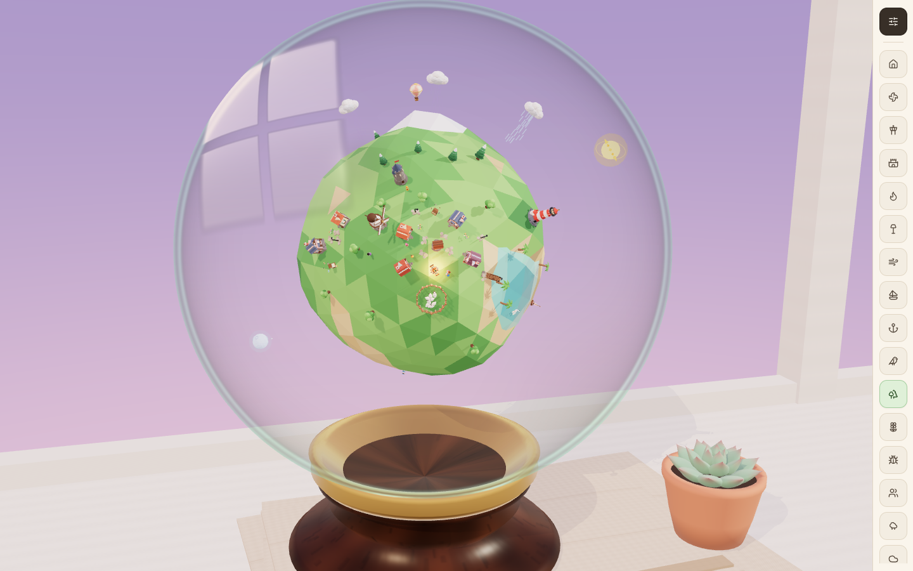
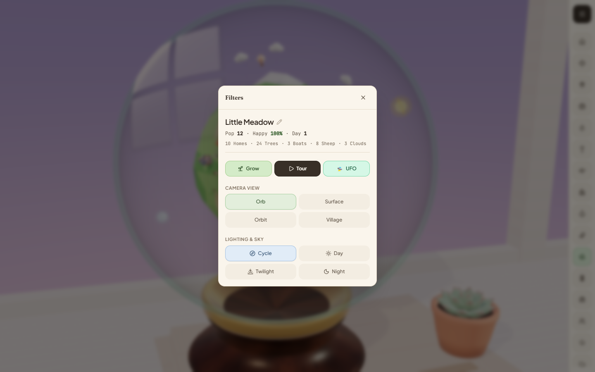

# Little Terrarium

A cozy miniature world builder in the browser. You shape a small faceted planet that floats inside a glass orb on a walnut stand. You can sculpt the terrain, build a village, add wildlife and weather, and watch day turn to night.

Built with React 19, Three.js, Vite and Tailwind CSS.

**▶ Try it live: [little-terrarium.vercel.app](https://little-terrarium.vercel.app/)**



## Getting started

Prerequisites: [Bun](https://bun.sh) (the repo includes a `bun.lock`) or Node.js 20+ with npm.

```bash
bun install
bun run dev
```

Then open http://localhost:3000.

With npm, run `npm install` and then `npm run dev`.

> The world isn't saved anywhere. Reloading the page starts you again with the default planet, *Little Meadow*.

## Using the app

### Screen layout

- **3D viewport**: takes up most of the screen and shows the planet in its glass orb.
- **Tool dock**:
  - On desktop, a thin column of icon buttons runs down the right-hand edge. Hover a button to see its name.
  - On mobile (narrower than 768px), the dock is a scrollable row along the bottom of the screen.
  - The selected tool is highlighted in its own accent colour.
- **Filters button**: the dark sliders button at the top of the desktop dock, or at the left of the mobile bar. It opens the Filters panel, which has the planet stats, actions, camera views and lighting.

### Mouse and keyboard

| Action | Input |
| --- | --- |
| Use the selected tool at a spot | Left-click on the planet (a ring under the cursor shows where it will land) |
| Spin the planet | Left- or right-click and drag (it keeps spinning a little after you let go) |
| Zoom in or out | Mouse wheel |
| Close the Filters panel | `Esc`, the ✕ button, or a click on the dimmed background |
| Stop the Tour | `Esc` |

A click only counts as a tool use if the pointer moves less than about 5px. Anything more is a drag, so you can spin the planet without placing things by accident.

### Tools

Each dock button selects a tool. The tool then acts wherever you left-click on the planet. The dock lists the tools in the groups below, from top to bottom.

#### Village & Landmarks

| Tool | What a click does |
| --- | --- |
| **Houses** | Builds a pastel cottage that faces the village well. Each house brings **2 new villagers**, and a house built near the well gets a stepping-stone path to it. |
| **Windmills** | Puts up a white windmill with turning sails, facing the well. |
| **Lighthouses** | Builds a striped lighthouse with a sweeping beam. It looks best on a coast. |
| **Watchtower** | Builds a stone keep with a waving pennant. |
| **Campfire** | Lights a stone campfire. Villagers gather round it at night. |
| **Lantern Road** | Places a streetlamp on a cobblestone path. It glows at dusk. |
| **Hot Air Balloon** | Launches a striped balloon that drifts above the surface. |

#### Water & Coastal Life

| Tool | What a click does |
| --- | --- |
| **Sailboats** | Launches a sailboat that wanders the sea and lights a lantern at night. If you click land, it goes to the nearest water. If there's no water nearby, a small lake is carved for it. |
| **Docks & Bridges** | Click **land near a shore** for a timber pier that points out to the water. Click **water** for an arched footbridge across the channel. |
| **Swans & Ducks** | Adds a paddling flock that leaves ripples. On land it follows the same rules as Sailboats. |

#### Nature & Life

| Tool | What a click does |
| --- | --- |
| **Trees** | Plants a tree that suits the spot: **palms** on beaches, **pines** on mountains and in the far north, and **oaks** everywhere else. |
| **Flowers** | Scatters a patch of pastel blossoms. |
| **Beehives** | Places a painted hive with bees and butterflies, plus a flower patch next to it. |
| **Villagers** | Adds a villager who walks between homes, campfires and the well. |
| **Sheep** | Adds a grazing sheep. |

#### Weather & Sky

| Tool | What a click does |
| --- | --- |
| **Rain Cloud** | Summons a cloud that circles the planet and rains. The rain helps trees underneath it grow. |
| **Snow Cloud** | Summons a cloud that dusts hills and roofs with snow. |
| **Rainbow** | Arches a see-through rainbow over the spot, angled so it doesn't run into nearby objects. |
| **Shooting Star** | Sends a shooting star across the sky inside the orb. It shows up best at night. |
| **UFO Encounter** | Brings in a flying saucer that picks the nearest villager and beams them up. A banner at the top of the screen announces it. **No more than 2 UFOs can be on screen at once.** |

#### Sculpt & Clear

| Tool | What a click does |
| --- | --- |
| **Mountains** | Raises a snowy faceted peak. |
| **Lakes** | Carves a turquoise basin that goes from shallow to deep. |
| **Raise Land** | Lifts the terrain under the cursor. Use it to make islands or hills. |
| **Lower Land** | Sinks the terrain until water comes in. |
| **Remove** | Deletes the nearest building, tree, flower or other placed object, if there's one close enough. This includes the starting village, but not the central well. It also works on sailboats, duck flocks, balloons and UFOs. It can't remove villagers, sheep or clouds. |

Objects that sit on the terrain move with it when you sculpt underneath them. Land-based tools (houses, trees, villagers and so on) still work if you click water: a small patch of land is raised first and the object goes on top.

### Filters panel

Click the **Filters** button to open the panel. It has four sections.



1. **Planet info**
   - Click the planet name (with the ✎ icon) to rename it, then press Enter or click elsewhere to save. Names can be up to 28 characters, and an empty name goes back to *Little Meadow*.
   - Below the name are live stats: **Pop**, **Happy**, **Day**, and counts of homes, trees, boats, sheep, clouds and abducted villagers.
2. **Action buttons**
   - **Grow**: moves the village on a stage. It makes every tree bigger, adds a cottage near the well with a path and 2 villagers, plants a few trees and flowers, and adds one day to the day counter.
   - **Tour**: starts a 30-second camera tour of your planet (see below).
   - **🛸 UFO**: summons a UFO without having to pick a spot. It goes after a random villager.
3. **Camera View** (choosing one also stops a running tour)
   - **Orb**: the default shot, with the whole glass orb and stand.
   - **Surface**: a low view along the horizon, across beach, sea and hills.
   - **Orbit**: a close, centred view of the planet. This is the best view for building and sculpting.
   - **Village**: a close-up at street level, showing roofs, fences and sails.
4. **Lighting & Sky**
   - **Cycle**: day and night alternate on their own. A full day takes about 70 seconds, and the day counter goes up each time one ends.
   - **Day**, **Twilight** and **Night**: lock the lighting to that time. At twilight and night, windows, lanterns, campfires and lighthouses light up.

### The Tour

**Tour** plays a 30-second camera tour of your planet in four acts:

1. **0–8s**: The camera reveals the orb and circles the whole globe.
2. **8–15s**: Close-ups of the cottages, the sheep pasture and the coast.
3. **15–23s**: The tour builds a few things on its own, such as a windmill, a lighthouse, villagers and weather. These are added to your world.
4. **23–30s**: Sunset turns to night, a shooting star goes by, and the camera pulls back to the full orb.

While the tour runs, the dock and Filters panel are hidden and the mouse does nothing. Press `Esc` to stop it early.

### Tips

- Switch to the **Orbit** view before building. Placement is much easier than in the zoomed-out **Orb** view.
- Use **Lower Land** or **Lakes** to make seas before you add **Sailboats**, **Swans & Ducks** or **Docks & Bridges**.
- Build **Houses** near the well, in the middle of the starting village, so paths connect them.
- Pick **Night** to see the village lit up and get the best **Shooting Stars**.
- If the 3D view stops with a "Terrarium Viewport Paused" message, the browser has dropped the WebGL context. Reload the tab.

## Scripts

| Script | Description |
| --- | --- |
| `dev` | Start the Vite dev server on port 3000 (bound to `0.0.0.0`) |
| `build` | Production build into `dist/` |
| `preview` | Serve the production build locally |
| `lint` | Type-check with `tsc --noEmit` |
| `clean` | Remove build output |

## Environment

`.env.example` lists `GEMINI_API_KEY` and `APP_URL`. These come from the Google AI Studio template the project started from. The current client code doesn't read either one, so you don't need them to run the app locally.

Set `DISABLE_HMR=true` to turn off hot module reload and file watching in the dev server.

## Project structure

```
src/
├── App.tsx                    # UI shell: tool dock, Filters panel, stats, camera/time controls
├── main.tsx                   # React entry point
├── types/world.ts             # World state types and tool definitions
├── three/
│   ├── PocketWorldScene.ts    # Scene controller: camera, input, day/night, tour, simulation
│   ├── PlanetTerrain.ts       # Faceted spherical terrain and sculpting
│   ├── MiniatureObjects.ts    # Procedural models for buildings, creatures, weather, etc.
│   └── RoomEnvironment.ts     # Glass orb, walnut stand and surrounding room
└── utils/
    ├── textures.ts            # Procedurally generated textures
    └── ufoAudio.ts            # Web Audio sound effects for the UFO
```
